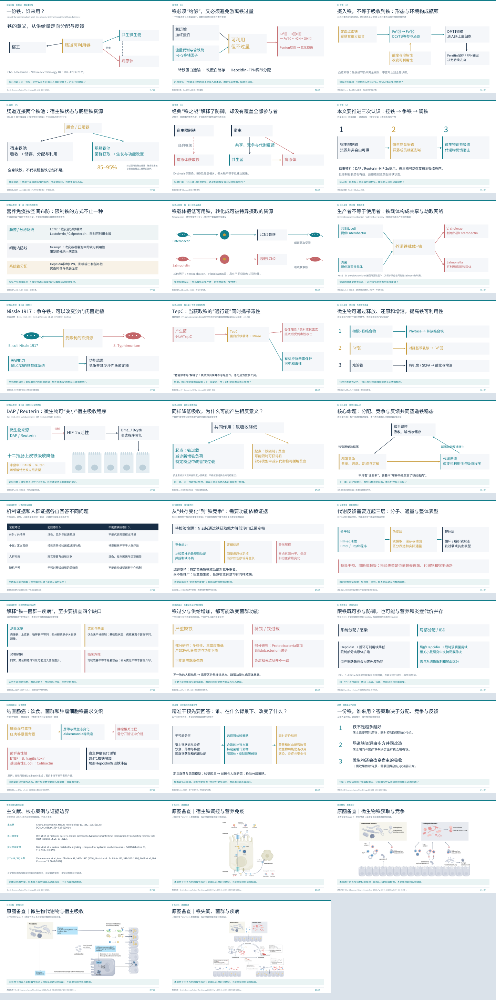

# 一份铁，谁来用？——铁与宿主微生物互作文献汇报

**新版：按四章结构重做叙事与图示。正文25页，另附4页原图备查，建议约25分钟。**

## 下载

- [可编辑PPT](journal_club.pptx)：正文机制图为可编辑矢量图，附逐页演讲者备注。
- [PDF预览](preview.pdf)
- [逐页讲稿](speaker_notes.md)
- [全套缩略图](overview.png)

在PPT文件页面点击 **Download raw file**（向下箭头）下载。也可在仓库首页点击 **Code → Download ZIP** 后解压。私有仓库需登录有访问权限的GitHub账号。

## 故事主线与结构

宿主需要铁 → 宿主限制铁 → 微生物争夺铁 → 微生物改变吸收 → 作用依赖背景 → 因果验证与分层干预。

1. 背景（第2–6页）：铁的双重性、吸收瓶颈、两个铁池、经典框架局限与本文问题。
2. 核心发现（第7–15页）：营养免疫、获取与逃逸、菌间网络、Nissle案例、TepC辅助案例、化学可利用性、DAP/Reuterin–HIF-2α与背景依赖。
3. 证据审视（第16–19页）：证据分工、两案例回扣、测量与对照缺口。
4. 疾病与精准干预（第20–23页）：缺铁/补铁、感染/IBD、结直肠癌与分层研究。
5. 总结和参考（第24–25页）；原图备查（第26–29页）。

## 图示与科学边界

正文机制图依据综述自行绘制，非定量实验图，不代表结构、比例或效应量；虚线用于待检验关联。原图取自上传论文，出处见页脚。各页注明来源或“汇报者归纳”，讲稿交代证据边界。

主文献为叙述性综述，所述实验结果来自其引用的原始研究。关键结果按综述转述，未补写未核实的样本量、剂量和统计显著性。85–95%为综述引用的稳态估计，不是所有饮食、铁状态或剂型的固定比例。

主文献：Choi G, Bessman NJ. *Nature Microbiology* 10, 1282–1293 (2025). DOI: [10.1038/s41564-025-02001-y](https://doi.org/10.1038/s41564-025-02001-y)。

